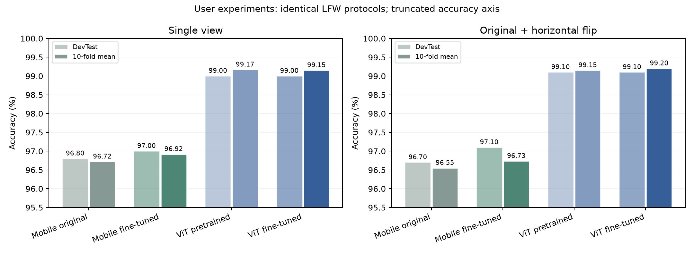
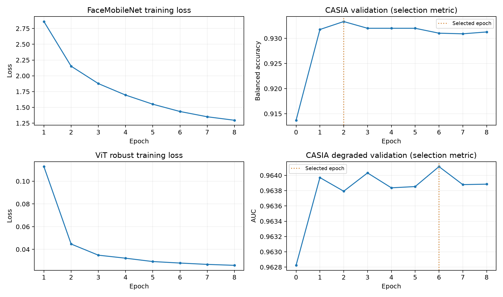

# 用户独立实验整理：FaceMobileNet 与 ViT

本节只整理 `artifacts/my_experiments/` 中用户本次完成的三组实验，不将此前自动实验的 99.22% 等结果混入本次复现。这里只读取记录与缓存，没有重新训练，也没有切换当前演示权重。

### 实验配置与核验

两组本地训练使用完全相同、顺序也相同的 CASIA 身份/图像清单：4,096 个训练身份、65,536 张训练图像；256 个验证身份、4,096 张验证图像，每人 16 张，seed=42，训练/验证身份交集为 0。三个评估目录的配对文件指纹、测试路径和重复基准结果一致；模型文件 SHA-256 与训练/评估记录相符。

| 设置 | 全网络微调 FaceMobileNet | 直接使用预训练 ViT | 质量加权增强微调 ViT |
|---|---|---|---|
| 初始化 | 项目原有 `18.pth` | CVLFace ViT-Base WebFace4M | 相同预训练 ViT |
| 输入 | 灰度 128×128 | RGB 112×112 | RGB 112×112 |
| 本地更新层 | 全网络（`--full`） | 不更新 | 最后 4 块、LayerNorm、特征投影；固定 BN |
| 训练轮数 / batch | 8 / 128 | 不适用 | 8 / 128 |
| 学习率 | 网络 5e-05，分类器 0.001 | 不适用 | 块 2e-05，特征头 4e-05，分类器 0.001 |
| 初始特征保持权重 | 10.0 | 不适用 | 2.0 |
| 训练目标与增强 | CosFace、特征保持、随机翻转 | 不适用 | 质量加权 CosFace、清晰目标一致性、翻转、50% 分辨率增强 |
| CASIA 模型选择规则 | 清晰验证 balanced accuracy 最大 | 不适用 | 降质验证 AUC 最大，且清晰 AUC 回退不超过 0.001 |
| 选中轮次 | 2 | 不适用 | 6 |
| 训练耗时（含初始化缓存等） | 402.77 秒 | 无训练 | 263.14 秒 |

两份训练清单相同，但脚本生成验证配对的顺序/随机过程和选模型目标不同，不能将两组 CASIA 验证数字当作完全同协议的模型排名。正式模型比较使用统一 LFW 配对。

### 评估协议

LFW DevTrain 2,200 对用于阈值校准；DevTest 1,000 对用于冻结阈值后的测试（同人、异人各 500 对）。校准与开发测试的身份、图像交集均为 0。另用标准 6,000 对做十折，每折用其余九折标定阈值、留出一折测试。十折标准差仅表示折间波动，不是置信区间。

`single` 仅原图，`flip` 融合原图和水平翻转图。以下同时保留两种设置，避免按不同模型挑选各自最好的设置造成混比。所有结果均为原始 LFW 裁剪图；本次没有额外运行降质 LFW 诊断或新增 CASIA 审计。

### 主对照：统一使用翻转融合

| 模型 | DevTest 准确率 | 标准十折均值 ± 标准差 | DevTest AUC | EER | FAR | FRR | 十折错误数 / 6000 |
|---|---:|---:|---:|---:|---:|---:|---:|
| 原始 FaceMobileNet | 96.70% | 96.55% ± 0.93% | 0.989524 | 3.60% | 1.60% | 5.00% | 207 |
| 本次微调 FaceMobileNet | 97.10% | 96.73% ± 0.85% | 0.991092 | 3.20% | 2.20% | 3.60% | 196 |
| 预训练 ViT | 99.10% | 99.15% ± 0.40% | 0.990520 | 1.60% | 0.00% | 1.80% | 51 |
| 本次微调 ViT | 99.10% | 99.20% ± 0.41% | 0.990468 | 1.60% | 0.00% | 1.80% | 48 |

### 补充对照：统一使用单视图

| 模型 | DevTest 准确率 | 标准十折均值 ± 标准差 | DevTest AUC | EER | FAR | FRR | 十折错误数 / 6000 |
|---|---:|---:|---:|---:|---:|---:|---:|
| 原始 FaceMobileNet | 96.80% | 96.72% ± 0.77% | 0.989868 | 3.40% | 2.00% | 4.40% | 197 |
| 本次微调 FaceMobileNet | 97.00% | 96.92% ± 0.85% | 0.991624 | 3.00% | 2.00% | 4.00% | 185 |
| 预训练 ViT | 99.00% | 99.17% ± 0.39% | 0.990292 | 1.60% | 0.00% | 2.00% | 50 |
| 本次微调 ViT | 99.00% | 99.15% ± 0.36% | 0.990228 | 1.60% | 0.00% | 2.00% | 51 |



### 结果分析

**FaceMobileNet 微调前后。** 翻转融合下 DevTest 从 96.70% 到 97.10%，变化 +0.40 个百分点，错误由 33 对变为 29 对；十折从 96.55% 到 96.73%，变化 +0.183 个百分点，错误从 207 对变为 196 对。与此同时 FAR 从 1.6% 到 2.2%，即误接受从 8 对变为 11 对；误拒绝从 25 对变为 18 对，说明总体准确率改善也可能伴随误接受增多。单视图十折从 96.72% 到 96.92%。

**ViT 微调前后。** 翻转融合下预训练和本次微调的 DevTest 分别为 99.10% 和 99.10%，错误分别为 9 对、9 对；十折从 99.15% 到 99.20%，变化 +0.050 个百分点，错误从 51 对变为 48 对，净少错 3 对。DevTest AUC 从 0.990520 到 0.990468；EER 从 1.6% 到 1.6%。单视图十折从 99.17% 到 99.15%。因此需要同时报告视图和各指标，不能把某一项的小幅收益写成全面优势。

**翻转融合不是必然提高所有成绩。** 本次 FaceMobileNet 微调模型的 DevTest 使用翻转由 97.0% 到 97.1%，十折由 96.92% 到 96.73%；本次 ViT 微调十折由单视图 99.15% 到翻转 99.20%。应同时报告，不能只根据测试分数为每个模型挑一种视图，再称之为受控比较。

**不同网络之间的比较。** 预训练 ViT 与本次 FaceMobileNet 微调的主对照 DevTest 为 99.1% 对 97.1%。但网络规模、RGB/灰度预处理、上游预训练数据与本地训练方式都不同，这只能说明这些完整方案在本地协议中的表现，不能单独证明 Transformer 结构必然胜过 CNN。AUC 衡量整个分数排序，Accuracy 衡量某个阈值，不应把两者混用。

对缓存特征重算逐对预测及十折结果，与记录一致。配对比较如下，“改正/新增错误”说明微调修正了多少旧错误、同时引入多少新错误：

| 比较 | DevTest 改正/新增错误 | 双侧精确 p | 十折改正/新增错误 | 双侧精确 p |
|---|---:|---:|---:|---:|
| FaceMobileNet 微调前后（翻转融合） | 9/5 | 0.4240 | 40/29 | 0.2284 |
| ViT 微调前后（翻转融合） | 0/0 | 1.0000 | 3/0 | 0.2500 |

p 值为描述性 McNemar 结果，图片对可能共享图片或人物，十折训练部分也相互重叠，不满足完全独立样本假设；不能据此替代多随机种子和新数据验证。

### 训练过程

FaceMobileNet 平均总损失由 2.860218 到 1.295646；CASIA 验证 balanced accuracy 初始为 91.37%，第 2 轮达到 93.33%。模型选择看验证表现，不能因为后续训练损失更低就默认使用最后一轮。

ViT 平均总损失由 0.112846 到 0.025960；降质 CASIA 验证 AUC 初始为 0.962823，按既定规则选中第 6 轮，其降质 AUC 为 0.964114，清晰 AUC 为 0.972378。这次选中轮次与此前自动实验不同；GPU 数值/训练波动可能影响微小差异，但本次没有对波动原因做受控验证。不能把此前少错 4 对的成绩替代本次实测净少错 3 对。



两组损失定义及权重不同，损失数值不能直接用来比较模型强弱。单一随机种子、小量错误差异和反复使用公开 LFW 都限制了结论强度；当前收益只能称为这次运行的实测小幅改善，不能声称统计显著或保证未公开测试也提高。

### 阈值与混淆矩阵（翻转融合）

| 模型 | DevTrain 阈值 | TP 正确同人 | FN 误拒绝 | FP 误接受 | TN 正确异人 |
|---|---:|---:|---:|---:|---:|
| 原始 FaceMobileNet | 0.379240 | 475 | 25 | 8 | 492 |
| 本次微调 FaceMobileNet | 0.349414 | 482 | 18 | 11 | 489 |
| 预训练 ViT | 0.270186 | 491 | 9 | 0 | 500 |
| 本次微调 ViT | 0.277991 | 491 | 9 | 0 | 500 |

阈值按模型分别在校准集标定。数值较高/较低本身不代表模型较好；余弦相似度不是概率。FAR=0 只表示这 500 对异人中未出现误接受，不代表实际风险为零。

### 指标速查

| 指标 | 解释 / 公式 | 方向 |
|---|---|---|
| Accuracy | `(TP+TN)/全部配对数` | 越高越好 |
| Balanced accuracy | `0.5 × [TP/(TP+FN) + TN/(TN+FP)]`，两类等权 | 越高越好 |
| TAR | `TP/(TP+FN)`，同人被正确接受的比例 | 越高越好 |
| FAR | `FP/(FP+TN)`，异人被误判同人的比例 | 越低越好 |
| FRR | `FN/(TP+FN)`，同人被误判异人的比例 | 越低越好 |
| AUC | ROC 曲线下面积，描述不同阈值下的分数排序/区分能力，不是准确率 | 越接近 1 越好 |
| EER | 随阈值变化时 FAR 与 FRR 相等附近的插值错误率，不一定对应部署阈值 | 越低越好 |
| 十折均值 / 标准差 | 10 个留出折准确率的均值及折间波动，不是均值的置信区间 | 结合样本量解释 |
| Calibration accuracy | 选阈值所用校准集上的表现，不能当独立测试分数 | 不用于替代测试 |

### 原始文件、权重与复现

本次汇总以 `vit_robust_eval/evaluation.json` 为统一主表，并交叉核对另两个目录中的相同基准。`finetuned_*` 是评估脚本给 `--checkpoint` 模型的固定名称：在 `mobile_eval` 它指 FaceMobileNet，在 `vit_pretrained_eval` 指未微调 ViT，在 `vit_robust_eval` 才指本次微调 ViT；脚本里通用 `selection` 文案不作为实际网络/选择规则的依据。重复条目按真实权重指纹去重，没有将一份权重当成多次独立实验。

| 模型 | SHA-256 |
|---|---|
| 原始 FaceMobileNet | `027bf59d0af6357ff7dcb13bc7fea6f3223fa023f20ebfbc1deac4ede32e632c` |
| 本次微调 FaceMobileNet | `aafc09b8ccb39f3dded7966eae6c7944003c0c1d81d6e569ff68fb5ecef38125` |
| 预训练 ViT | `5fafd6b7d599a3ede5fac5bd1d01ad05e9e93e89b39b7687d4a3bc93ff2aebc0` |
| 本次微调 ViT | `a76bb8aff4560e132121298a8165729f4ef504df600e6a3e4921951a4ab22049` |

原始结果目录：`artifacts/my_experiments/mobile_eval/`、`vit_pretrained_eval/`、`vit_robust_eval/`。训练记录：`mobile_train/training.json`、`vit_robust_train/training.json`；两组 `split.json` 完全相同。

整理脚本：`python scripts/summarize_experiments.py`。输出为 `artifacts/my_experiments/summary/summary.md`、`summary.json`、`comparison.csv` 和两张图。CSV 数值用 0~1 原始比例，百分比显示时乘以 100；本脚本不更换默认推理权重或校准文件。

使用本次 ViT 模型演示：

```bash
FACE_DEVICE=cuda:7 FACE_CHECKPOINT=checkpoints/my_experiments/vit_robust.pth FACE_CALIBRATION=artifacts/my_experiments/vit_robust_eval/calibration.json python app.py
```
