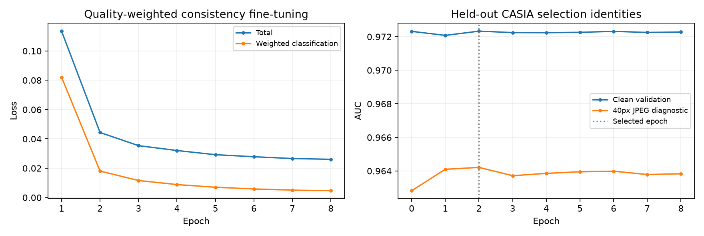
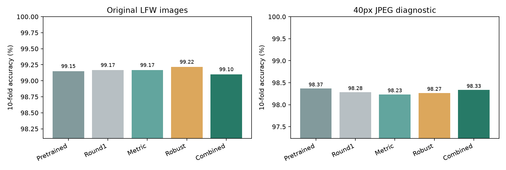
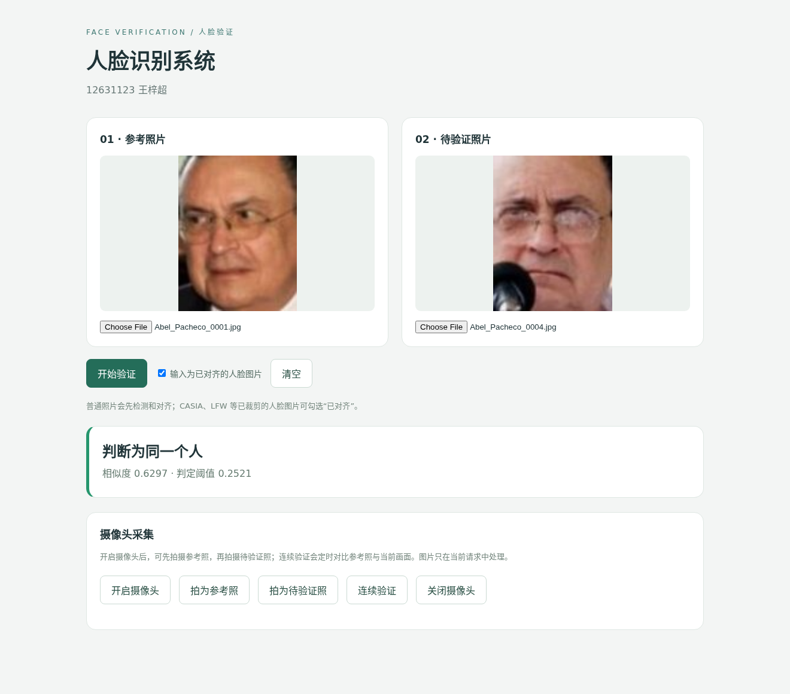

# Face Verification 实验报告：质量加权一致性微调与类内变化抑制

## 1. 任务、运行与交付

按 `说明.docx` 提供 `Y = FaceVerification(X1, X2)`，输入两张已对齐人脸图像路径，返回 Python `int`：同人 1、异人 0。普通照片由 YuNet 检测、五点相似变换对齐，网页支持上传照片、摄像头拍照与连续验证。

本轮针对“普通微调与预训练 ViT 准确率基本持平”的问题，在同一预训练初始化上探索质量加权的清晰目标一致性微调、类内变化抑制投影及其组合。选择结果为 **增强微调 + 类内变化抑制投影**；方法选择只看 CASIA 验证身份，选择记录写入后才执行本轮最终 LFW 和新增 CASIA 审计评估。

本轮实测的明确收益包括：**单独质量加权增强微调**在原始 LFW 十折准确率上从预训练的 99.15% 到 99.22%，提高 0.067 个百分点，6,000 对中从 51 个错误减至 47 个；**按 CASIA 规则选中的组合方法**在降质 DevTest 上从 98.10% 到 98.30%。这是不同设置下的有限改进，不代表同一模型在所有指标上都更好。

```bash
cd /home/wzc/datasets/casia/faceRecognitionCASIA
python -m pip install -r requirements.txt
FACE_DEVICE=cuda:7 python app.py
```

访问 `http://127.0.0.1:7860`，普通照片自动检测对齐；已对齐图像勾选相应选项。单卡环境把 `cuda:7` 换成 `cuda:0` 或 `cuda`。没有 CUDA 时可在 CPU 推理。图片不保存到服务器文件。

```python
from FaceVerification import FaceVerification
root = "datasets/scikit_learn_data/lfw_home/lfw_funeled_cropped"
Y = FaceVerification(root + "/Abel_Pacheco/Abel_Pacheco_0001.jpg",
                     root + "/Abel_Pacheco/Abel_Pacheco_0004.jpg")
print(Y)  # int: 1 or 0
```

普通照片命令行：`python verification.py samples/009.jpg samples/009.jpg --detect`。
默认权重 `checkpoints/transformer.pth`，配套阈值 `artifacts/calibration.json`，相似度大于等于 0.252063662 判为同人。模型与阈值通过 SHA-256 校验，分数不是概率。权重约 438 MiB，被 Git 忽略；迁移需单独复制最终权重与配套阈值，或复现实验。

## 2. 贡献与结论的边界

我们不把“换用了更强的预训练骨干”全部称作自己的贡献，也不声称下述已有技术为论文级新算法。本轮贡献是一个可复现、有明确对照的迁移方案：用训练身份的初始特征一致性估计样本权重，以清晰图像特征指导降质输入，再学习一个抑制同人变化方向的正则化度量；附带各模块消融和独立身份审计。

下面直接给出最终选定方法相对**完全相同预训练 ViT 初始化、同样翻转融合**的准确率变化，单位为百分点。原始协议与额外降质诊断分开，不能用诊断成绩替换原始 LFW 成绩。

| 条件 | LFW DevTest 变化 | LFW 标准十折变化 | 新增 CASIA 审计变化 |
|---|---:|---:|---:|
| 原始清晰图像 | +0.000 | -0.050 | +0.049 |
| 低分辨率/JPEG 诊断 | +0.200 | -0.033 | +0.244 |

零或负值均保留。微小变化不能自动称为统计显著提升。公开 LFW 已在前轮被观察，本轮结果属于公开基准的重复评估，不能宣称它是从未看过的外部保留集。教师未公开测试集尚未提供。

若只希望体验没有附加类内投影的梯度微调版本，可使用 `checkpoints/transformer_robust.pth` 搭配 `artifacts/refinement/calibration_robust.json`。它是完整消融中的预定候选，不因看到 LFW 分数而替换默认模型；其十折提升仅相当于少错 4 对，不宣称统计显著。默认组合版本保留 CASIA AUC 的选择规则。

## 3. 初始化、数据与许可

骨干来自 CVLFace 作者的 `minchul/cvlface_adaface_vit_base_webface4m`，固定版本 `c6fed2ff09ac0a29cccc72c09127ad7b4bd3fa9e`，初始化 SHA-256 为 `5fafd6b7d599a3ede5fac5bd1d01ad05e9e93e89b39b7687d4a3bc93ff2aebc0`。作者声明使用 WebFace4M、AdaFace 预训练，本次未下载其原始数据。代码采用 MIT 许可证，模型卡要求遵守训练数据许可；详见 `third_party/`。

ViT 输入 RGB 112×112，8×8 patch，196 token，内部维度 512，24 个 Transformer 块、16 头注意力、扩展比 3 的 ReLU6 MLP，最终投影为 512 维。原生 PyTorch SDPA 与显式注意力公式一致，测试覆盖；不执行模型仓库远程 Python。

本地 CASIA 版本有 10,575 个身份目录、454,191 张 JPG。沿用固定种子 42 的 4,096 个训练身份、65,536 张图像；256 个验证身份、4,096 张图像与训练身份不重叠。它们可能与上游预训练人物重叠，因此“未见身份”仅指未参与本地训练。

额外审计集从其余 CASIA 身份中以种子 314 选择 256 个身份，每人 16 张，不与训练/选模型身份重叠。前 128 个身份标定审计阈值，后 128 个身份评估，共 4,096 对测试配对；这些身份的结果不参与方法选择。清单保存于 `artifacts/refinement/audit_split.json`。

## 4. 方法

### 4.1 质量加权的一致性微调

先缓存初始化网络对每张训练图像及其翻转的单位特征。每个训练身份的融合特征求均值并归一化为原型。样本与其身份原型的余弦相似度为 q，权重 `w=clip((q-0.25)/0.5,0,1)`。这只是训练集内的特征一致性启发式，不是已标定的人脸质量概率；它可能降低离群/错误标注样本的影响，也可能抑制真正困难样本。

每张输入以 0.5 概率水平翻转；每批另以 0.5 概率选中部分图像，将其降至 40、56 或 72 像素再恢复为 112（尺寸随批次循环）。无论输入是否降质，保持目标都是相应清晰图像/翻转图的初始化特征。训练没有使用 LFW 图像或标签。

```text
L = weighted_mean(CrossEntropy(CosFace(f(x_aug), y)), w)
  + 2 × weighted_mean(1 - <normalize(f(x_aug)), e_initial_clean>, w)
```

CosFace 尺度 32、间隔 0.15；分类器由训练身份原型初始化。训练最后 4 个 Transformer 块、最终 LayerNorm 和两个特征投影矩阵，冻结前 20 块以及 BN 参数和统计。AdamW：块学习率 0.00002、特征头 0.00004、分类器 0.001，weight decay=0.0001，batch=128，BF16，8 轮，余弦学习率调度、梯度范数上限 5。当前 GPU 为 NVIDIA RTX PRO 6000 Blackwell Workstation Edition，实际运行 `cuda:7`。

训练损失从 0.113520 降至 0.026086；第 2 轮按 CASIA 降质验证 AUC 选中，并要求清晰验证 AUC 相对初始化下降不超过 0.001。共 62,147,500 个浮点值实际改变，48 个张量发生变化。初始清晰验证 AUC=0.972320，降质验证 AUC=0.962823；训练和选模型记录见 `artifacts/refinement/robust_training/training.json`。



### 4.2 正则化类内变化抑制投影

先在 CASIA 训练身份中取原图/翻转融合的单位特征，过滤与该身份中心余弦相似度小于 0.3 的极端离群样本；重新计算各身份均值后，用残差估计类内协方差 `Cw`。采用收缩正则和部分白化：

```text
C_reg = (1 - lambda) × Cw + lambda × trace(Cw)/512 × I
W = C_reg^(-alpha/2)
e = normalize(W × f(x))
```

按特征值分解计算 W，并归一化其几何平均尺度。正则 `lambda∈{0.05,0.2,0.5}`、强度 `alpha∈{0.25,0.5,0.75,1.0}`，共 12 个配置，只用 CASIA 清晰验证 AUC 选择；恒等变换也作为候选，避免强行添加无收益投影。该投影是基于标签的闭式度量拟合，不是梯度更新，报告不将其称为新增的 Transformer 反向训练。

分别在初始化 ViT 和增强微调 ViT 上拟合投影，形成模块消融。最终推理只多一个 512×512 线性矩阵，不读取测试身份、不按人名设置规则，也不在推理时查询标签。

### 4.3 翻转融合、模型选择与阈值

所有主比较均分别提取原图与翻转图特征，归一化后相加并再次归一化。投影存在时在每个视图归一化前应用。余弦相似度越高越可能同人。

候选方法比较清晰/降质 CASIA 验证 AUC 的平均值，并要求清晰 AUC 不低于初始化减 0.001；该规则记录在本轮 LFW 最终评估前保存的 `experiment_plan.json`。选择表如下：

| 方法 | 清晰验证 AUC | 降质验证 AUC | 平均选择分数 |
|---|---:|---:|---:|
| 原预训练 ViT | 0.972318 | 0.962777 | 0.967548 |
| 仅类内变化抑制投影 | 0.974613 | 0.964649 | 0.969631 |
| 质量加权增强微调 | 0.972340 | 0.964182 | 0.968261 |
| 增强微调 + 类内变化抑制投影 | 0.974626 | 0.966079 | 0.970353 |

选择结果：**增强微调 + 类内变化抑制投影**。完整配置尝试均保留，不根据以下 LFW 结果重新选择默认方法。

## 5. 评估协议

原始 LFW DevTrain 2,200 对仅标定阈值，DevTest 1,000 对（正负各 500 对）计算准确率；标准 6,000 对按官方十折顺序，每折在其余九折选择阈值，留出一折测试。十折标准差是折间波动，不是置信区间。清晰结果保持原始图像、标签和协议。

额外降质诊断对每张图像固定执行：双线性缩至 40×40 → JPEG quality=45 → 双线性恢复 112×112。每个模型处理完全相同的降质输入；在降质 DevTrain 上各自标定阈值，在降质 DevTest/十折评估。新增 CASIA 审计也分别以清晰/降质校准与测试。

这是一项有意贴近训练降质方向的诊断，能够说明该条件下的稳健性，不能外推为所有真实低质量照片或官方新的 LFW 成绩。训练增强不含 JPEG 编码，诊断包含 JPEG；仍需真实拍摄数据做外部验证。

## 6. 完整对照和消融结果

### 6.1 原始清晰输入

| 方法 | DevTest 准确率 | 标准十折准确率 | DevTest AUC | 新增 CASIA 审计准确率 | 审计 AUC |
|---|---:|---:|---:|---:|---:|
| 原预训练 ViT | 99.10% | 99.15% ± 0.40% | 0.990520 | 96.29% | 0.976982 |
| 上一轮普通微调 | 99.10% | 99.17% ± 0.39% | 0.990544 | 96.29% | 0.977422 |
| 仅类内变化抑制投影 | 99.10% | 99.17% ± 0.38% | 0.991532 | 96.19% | 0.978682 |
| 质量加权增强微调 | 99.10% | 99.22% ± 0.42% | 0.990204 | 96.34% | 0.976974 |
| 增强微调 + 类内变化抑制投影（选定） | 99.10% | 99.10% ± 0.36% | 0.991264 | 96.34% | 0.978775 |

### 6.2 低分辨率/JPEG 诊断输入（额外协议）

| 方法 | DevTest 准确率 | 标准十折准确率 | DevTest AUC | 新增 CASIA 审计准确率 | 审计 AUC |
|---|---:|---:|---:|---:|---:|
| 原预训练 ViT | 98.10% | 98.37% ± 0.39% | 0.990548 | 93.14% | 0.967081 |
| 上一轮普通微调 | 97.90% | 98.28% ± 0.49% | 0.990604 | 93.19% | 0.967884 |
| 仅类内变化抑制投影 | 97.90% | 98.23% ± 0.59% | 0.991620 | 93.09% | 0.967360 |
| 质量加权增强微调 | 98.00% | 98.27% ± 0.40% | 0.990456 | 93.31% | 0.967966 |
| 增强微调 + 类内变化抑制投影（选定） | 98.30% | 98.33% ± 0.52% | 0.991592 | 93.38% | 0.968462 |



原始清晰 DevTest 最终混淆矩阵：TP=491、FN=9、FP=0、TN=500；降质诊断为 TP=489、FN=11、FP=6、TN=494。这些都是有限样本计数，FAR=0 不代表真实误接受风险为零。

所有方法、条件、每折指标保存于 `artifacts/refinement/evaluation.json`。初次普通 ViT 微调记录与权重保留在 `experiments/vit_round1/` 和 `checkpoints/transformer_round1.pth`，失败或未选中的本轮候选也保留。新默认文件 SHA-256：`216fe45a7f4d90e3bb11172ba310c0d3c31bd87e0e8805bb7a87a426711f7ad2`。

## 7. 复现与系统测试

```bash
python -m pip install -r requirements-dev.txt
python scripts/download_transformer.py
python scripts/run_refinement.py --device cuda:7
```

上述流程会依次训练增强版本、拟合两个投影、在 CASIA 验证集选择并启用默认权重、执行统一原始评估与本轮附加诊断、更新计时和报告。GPU 编号应根据机器调整；需要现有 CASIA/LFW 数据与原网络对照权重。默认 8 轮使用完整固定子集，耗时依赖硬件、缓存和磁盘。分步命令见 README。

已有模型仅需 `python app.py`。复核代码：`python -m pytest -q`。测试覆盖接口/阈值/配对、单脸与多脸处理、RGB 预处理、注意力等价、冻结前缀梯度、BN 统计、诊断确定性以及恒等投影前后输出一致性。系统验证使用最终模型与其校准文件。

设备 `cuda:7` 上加载模型后的双图接口平均 21.86 ms，单图检测与对齐平均 4.06 ms，各测量 10 次。GPU 计时前后同步，不含首次模型加载。

新模型通过 6 项浏览器检查与 4 项模拟摄像头检查，真实摄像头硬件未测试。

自动测试 16 项通过，失败 0 项，记录位于 `artifacts/test_validation.json`。



## 8. 局限与诚实解释

1. 结构、CosFace、特征保持和类内白化均有既有研究基础；本次是任务导向的组合与受控探索，不声称提出全新通用算法。
2. 质量权重、训练增强和额外投影可能影响不同人群与困难姿态；质量启发式不是标注真值，可能错误抑制困难但正确的样本。
3. 明确区分预训练收益、本轮微调收益、类内投影收益，清晰/降质条件的零收益或回退不能隐藏。很小的百分点变化需要更多样本和多个随机种子验证。
4. 只有一组训练随机种子；公开 LFW 已多轮观察，跨轮实验存在适应公开基准的风险。新增 CASIA 审计不参与选模型，但与 CASIA 同域且可能与上游预训练身份重叠。
5. 未公开测试、真实设备低质量采集及活体检测均未评估。照片相似性验证不能等同于安全身份认证。

## 9. 参考资料与致谢

- [CVLFace](https://github.com/mk-minchul/CVLface)及[固定初始化模型](https://huggingface.co/minchul/cvlface_adaface_vit_base_webface4m/tree/c6fed2ff09ac0a29cccc72c09127ad7b4bd3fa9e)，许可见 `third_party/`。
- [Vision Transformer 原论文](https://arxiv.org/abs/2010.11929)、[AdaFace 原论文](https://arxiv.org/abs/2204.00964)：分别为骨干与初始化来源。本轮质量启发式不是 AdaFace 自适应间隔的复现。
- [CosFace 原论文](https://openaccess.thecvf.com/content_cvpr_2018/html/Wang_CosFace_Large_Margin_CVPR_2018_paper.html)。
- [YuNet 官方实现与模型](https://github.com/opencv/opencv_zoo/tree/main/models/face_detection_yunet)。
- 原始 `legacy/README.md`、`blog/` 及其对 insightface、InsightFace_Pytorch、arcface-pytorch 的致谢。

<!-- USER_EXPERIMENTS_START -->
## 10. 用户独立复现实验

本节只整理 `artifacts/my_experiments/` 中用户本次完成的三组实验，不将此前自动实验的 99.22% 等结果混入本次复现。这里只读取记录与缓存，没有重新训练，也没有切换当前演示权重。

### 实验配置与核验

两组本地训练使用完全相同、顺序也相同的 CASIA 身份/图像清单：4,096 个训练身份、65,536 张训练图像；256 个验证身份、4,096 张验证图像，每人 16 张，seed=42，训练/验证身份交集为 0。三个评估目录的配对文件指纹、测试路径和重复基准结果一致；模型文件 SHA-256 与训练/评估记录相符。

| 设置 | 全网络微调 FaceMobileNet | 直接使用预训练 ViT | 质量加权增强微调 ViT |
|---|---|---|---|
| 初始化 | 项目原有 `18.pth` | CVLFace ViT-Base WebFace4M | 相同预训练 ViT |
| 输入 | 灰度 128×128 | RGB 112×112 | RGB 112×112 |
| 本地更新层 | 全网络（`--full`） | 不更新 | 最后 4 块、LayerNorm、特征投影；固定 BN |
| 训练轮数 / batch | 8 / 128 | 不适用 | 8 / 128 |
| 学习率 | 网络 5e-05，分类器 0.001 | 不适用 | 块 2e-05，特征头 4e-05，分类器 0.001 |
| 初始特征保持权重 | 10.0 | 不适用 | 2.0 |
| 训练目标与增强 | CosFace、特征保持、随机翻转 | 不适用 | 质量加权 CosFace、清晰目标一致性、翻转、50% 分辨率增强 |
| CASIA 模型选择规则 | 清晰验证 balanced accuracy 最大 | 不适用 | 降质验证 AUC 最大，且清晰 AUC 回退不超过 0.001 |
| 选中轮次 | 2 | 不适用 | 6 |
| 训练耗时（含初始化缓存等） | 402.77 秒 | 无训练 | 263.14 秒 |

两份训练清单相同，但脚本生成验证配对的顺序/随机过程和选模型目标不同，不能将两组 CASIA 验证数字当作完全同协议的模型排名。正式模型比较使用统一 LFW 配对。

### 评估协议

LFW DevTrain 2,200 对用于阈值校准；DevTest 1,000 对用于冻结阈值后的测试（同人、异人各 500 对）。校准与开发测试的身份、图像交集均为 0。另用标准 6,000 对做十折，每折用其余九折标定阈值、留出一折测试。十折标准差仅表示折间波动，不是置信区间。

`single` 仅原图，`flip` 融合原图和水平翻转图。以下同时保留两种设置，避免按不同模型挑选各自最好的设置造成混比。所有结果均为原始 LFW 裁剪图；本次没有额外运行降质 LFW 诊断或新增 CASIA 审计。

### 主对照：统一使用翻转融合

| 模型 | DevTest 准确率 | 标准十折均值 ± 标准差 | DevTest AUC | EER | FAR | FRR | 十折错误数 / 6000 |
|---|---:|---:|---:|---:|---:|---:|---:|
| 原始 FaceMobileNet | 96.70% | 96.55% ± 0.93% | 0.989524 | 3.60% | 1.60% | 5.00% | 207 |
| 本次微调 FaceMobileNet | 97.10% | 96.73% ± 0.85% | 0.991092 | 3.20% | 2.20% | 3.60% | 196 |
| 预训练 ViT | 99.10% | 99.15% ± 0.40% | 0.990520 | 1.60% | 0.00% | 1.80% | 51 |
| 本次微调 ViT | 99.10% | 99.20% ± 0.41% | 0.990468 | 1.60% | 0.00% | 1.80% | 48 |

### 补充对照：统一使用单视图

| 模型 | DevTest 准确率 | 标准十折均值 ± 标准差 | DevTest AUC | EER | FAR | FRR | 十折错误数 / 6000 |
|---|---:|---:|---:|---:|---:|---:|---:|
| 原始 FaceMobileNet | 96.80% | 96.72% ± 0.77% | 0.989868 | 3.40% | 2.00% | 4.40% | 197 |
| 本次微调 FaceMobileNet | 97.00% | 96.92% ± 0.85% | 0.991624 | 3.00% | 2.00% | 4.00% | 185 |
| 预训练 ViT | 99.00% | 99.17% ± 0.39% | 0.990292 | 1.60% | 0.00% | 2.00% | 50 |
| 本次微调 ViT | 99.00% | 99.15% ± 0.36% | 0.990228 | 1.60% | 0.00% | 2.00% | 51 |


### 结果分析

**FaceMobileNet 微调前后。** 翻转融合下 DevTest 从 96.70% 到 97.10%，变化 +0.40 个百分点，错误由 33 对变为 29 对；十折从 96.55% 到 96.73%，变化 +0.183 个百分点，错误从 207 对变为 196 对。与此同时 FAR 从 1.6% 到 2.2%，即误接受从 8 对变为 11 对；误拒绝从 25 对变为 18 对，说明总体准确率改善也可能伴随误接受增多。单视图十折从 96.72% 到 96.92%。

**ViT 微调前后。** 翻转融合下预训练和本次微调的 DevTest 分别为 99.10% 和 99.10%，错误分别为 9 对、9 对；十折从 99.15% 到 99.20%，变化 +0.050 个百分点，错误从 51 对变为 48 对，净少错 3 对。DevTest AUC 从 0.990520 到 0.990468；EER 从 1.6% 到 1.6%。单视图十折从 99.17% 到 99.15%。因此需要同时报告视图和各指标，不能把某一项的小幅收益写成全面优势。

**翻转融合不是必然提高所有成绩。** 本次 FaceMobileNet 微调模型的 DevTest 使用翻转由 97.0% 到 97.1%，十折由 96.92% 到 96.73%；本次 ViT 微调十折由单视图 99.15% 到翻转 99.20%。应同时报告，不能只根据测试分数为每个模型挑一种视图，再称之为受控比较。

**不同网络之间的比较。** 预训练 ViT 与本次 FaceMobileNet 微调的主对照 DevTest 为 99.1% 对 97.1%。但网络规模、RGB/灰度预处理、上游预训练数据与本地训练方式都不同，这只能说明这些完整方案在本地协议中的表现，不能单独证明 Transformer 结构必然胜过 CNN。AUC 衡量整个分数排序，Accuracy 衡量某个阈值，不应把两者混用。

对缓存特征重算逐对预测及十折结果，与记录一致。配对比较如下，“改正/新增错误”说明微调修正了多少旧错误、同时引入多少新错误：

| 比较 | DevTest 改正/新增错误 | 双侧精确 p | 十折改正/新增错误 | 双侧精确 p |
|---|---:|---:|---:|---:|
| FaceMobileNet 微调前后（翻转融合） | 9/5 | 0.4240 | 40/29 | 0.2284 |
| ViT 微调前后（翻转融合） | 0/0 | 1.0000 | 3/0 | 0.2500 |

p 值为描述性 McNemar 结果，图片对可能共享图片或人物，十折训练部分也相互重叠，不满足完全独立样本假设；不能据此替代多随机种子和新数据验证。

### 训练过程

FaceMobileNet 平均总损失由 2.860218 到 1.295646；CASIA 验证 balanced accuracy 初始为 91.37%，第 2 轮达到 93.33%。模型选择看验证表现，不能因为后续训练损失更低就默认使用最后一轮。

ViT 平均总损失由 0.112846 到 0.025960；降质 CASIA 验证 AUC 初始为 0.962823，按既定规则选中第 6 轮，其降质 AUC 为 0.964114，清晰 AUC 为 0.972378。这次选中轮次与此前自动实验不同；GPU 数值/训练波动可能影响微小差异，但本次没有对波动原因做受控验证。不能把此前少错 4 对的成绩替代本次实测净少错 3 对。


两组损失定义及权重不同，损失数值不能直接用来比较模型强弱。单一随机种子、小量错误差异和反复使用公开 LFW 都限制了结论强度；当前收益只能称为这次运行的实测小幅改善，不能声称统计显著或保证未公开测试也提高。

### 阈值与混淆矩阵（翻转融合）

| 模型 | DevTrain 阈值 | TP 正确同人 | FN 误拒绝 | FP 误接受 | TN 正确异人 |
|---|---:|---:|---:|---:|---:|
| 原始 FaceMobileNet | 0.379240 | 475 | 25 | 8 | 492 |
| 本次微调 FaceMobileNet | 0.349414 | 482 | 18 | 11 | 489 |
| 预训练 ViT | 0.270186 | 491 | 9 | 0 | 500 |
| 本次微调 ViT | 0.277991 | 491 | 9 | 0 | 500 |

阈值按模型分别在校准集标定。数值较高/较低本身不代表模型较好；余弦相似度不是概率。FAR=0 只表示这 500 对异人中未出现误接受，不代表实际风险为零。

### 指标速查

| 指标 | 解释 / 公式 | 方向 |
|---|---|---|
| Accuracy | `(TP+TN)/全部配对数` | 越高越好 |
| Balanced accuracy | `0.5 × [TP/(TP+FN) + TN/(TN+FP)]`，两类等权 | 越高越好 |
| TAR | `TP/(TP+FN)`，同人被正确接受的比例 | 越高越好 |
| FAR | `FP/(FP+TN)`，异人被误判同人的比例 | 越低越好 |
| FRR | `FN/(TP+FN)`，同人被误判异人的比例 | 越低越好 |
| AUC | ROC 曲线下面积，描述不同阈值下的分数排序/区分能力，不是准确率 | 越接近 1 越好 |
| EER | 随阈值变化时 FAR 与 FRR 相等附近的插值错误率，不一定对应部署阈值 | 越低越好 |
| 十折均值 / 标准差 | 10 个留出折准确率的均值及折间波动，不是均值的置信区间 | 结合样本量解释 |
| Calibration accuracy | 选阈值所用校准集上的表现，不能当独立测试分数 | 不用于替代测试 |

### 原始文件、权重与复现

本次汇总以 `vit_robust_eval/evaluation.json` 为统一主表，并交叉核对另两个目录中的相同基准。`finetuned_*` 是评估脚本给 `--checkpoint` 模型的固定名称：在 `mobile_eval` 它指 FaceMobileNet，在 `vit_pretrained_eval` 指未微调 ViT，在 `vit_robust_eval` 才指本次微调 ViT；脚本里通用 `selection` 文案不作为实际网络/选择规则的依据。重复条目按真实权重指纹去重，没有将一份权重当成多次独立实验。

| 模型 | SHA-256 |
|---|---|
| 原始 FaceMobileNet | `027bf59d0af6357ff7dcb13bc7fea6f3223fa023f20ebfbc1deac4ede32e632c` |
| 本次微调 FaceMobileNet | `aafc09b8ccb39f3dded7966eae6c7944003c0c1d81d6e569ff68fb5ecef38125` |
| 预训练 ViT | `5fafd6b7d599a3ede5fac5bd1d01ad05e9e93e89b39b7687d4a3bc93ff2aebc0` |
| 本次微调 ViT | `a76bb8aff4560e132121298a8165729f4ef504df600e6a3e4921951a4ab22049` |

原始结果目录：`artifacts/my_experiments/mobile_eval/`、`vit_pretrained_eval/`、`vit_robust_eval/`。训练记录：`mobile_train/training.json`、`vit_robust_train/training.json`；两组 `split.json` 完全相同。

整理脚本：`python scripts/summarize_experiments.py`。输出为 `artifacts/my_experiments/summary/summary.md`、`summary.json`、`comparison.csv` 和两张图。CSV 数值用 0~1 原始比例，百分比显示时乘以 100；本脚本不更换默认推理权重或校准文件。

使用本次 ViT 模型演示：

```bash
FACE_DEVICE=cuda:7 FACE_CHECKPOINT=checkpoints/my_experiments/vit_robust.pth FACE_CALIBRATION=artifacts/my_experiments/vit_robust_eval/calibration.json python app.py
```

<!-- USER_EXPERIMENTS_END -->
